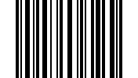
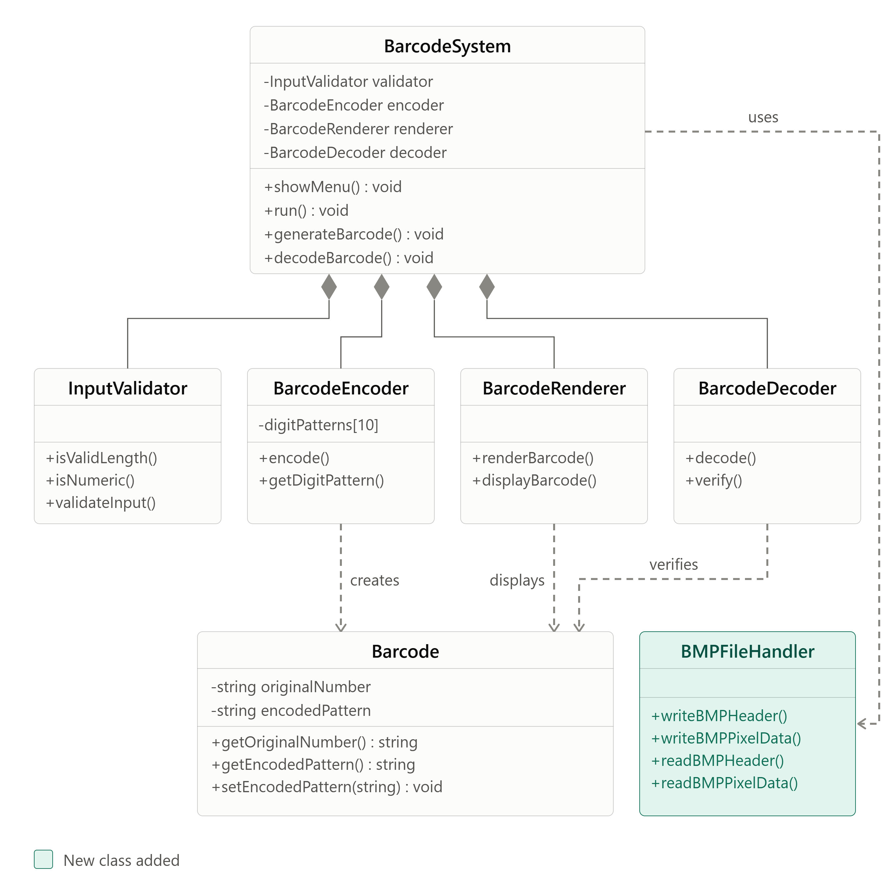

# Barcode Generator & Reader

> **Course:** Introduction to Software Engineering (SE-1001)
> **Section:** BSE-3B
> **Milestone:** Increment 1 complete
> **Methodology:** Incremental Model

---

## Table of Contents

1. [Project Overview](#1-project-overview)
2. [Features](#2-features)
3. [Team Members & Roles](#3-team-members--roles)
4. [Process](#4-process)
5. [Increment 1 Scope & Deliverables](#5-increment-1-scope--deliverables)
6. [Tech Stack](#6-tech-stack)
7. [Project Architecture](#7-project-architecture)
8. [Application Workflow](#8-application-workflow)
9. [Getting Started](#9-getting-started)
10. [Usage](#10-usage)
11. [Testing](#11-testing)
12. [Error Handling](#12-error-handling)
13. [Known Limitations](#13-known-limitations)
14. [Future Increments](#14-future-increments)

---

## 1. Project Overview

This project is the first increment of a standalone C++ desktop application for a small super store (or corner shop). The long-term goal is to let a cashier scan a product barcode to see product information, add it to an order, and produce a bill, while a manager can generate barcodes for store products.

**Increment 1** builds the foundation: a barcode **generator** and **reader**. The barcode is created entirely by our own code (no barcode libraries), saved as a BMP image, and can be read back from that image to recover the original 6-digit number.

---

## 2. Features

- Generate a barcode from a 6-digit number (the first digit must be non-zero).
- Convert the barcode pattern into a black-and-white pixel matrix and save it as a BMP image.
- Load a BMP image and scan it for a barcode.
- Decode the scanned barcode back into its 6-digit number.
- Validate user input, BMP headers and decoded results (including checksum verification).
- Reject invalid input and unsupported or corrupted image files with clear failures instead of crashes.

---

## 3. Team Members & Roles

Our 5-member team worked under Scrum roles throughout Increment 1.

| Name | Role | Core Responsibilities |
| :--- | :--- | :--- |
| **Rabiya Rana (25L-3006)** | Developer | **Input validation and barcode encoding:** validating the six-digit input, generating per-digit barcode patterns, encoding the full barcode sequence, and creating BMP file headers. |
| **Hafsa Usman (25L-3097)** | Developer | **Barcode rendering and image writing:** validating encoded data, converting patterns into a black-and-white pixel matrix, rendering the barcode, and writing pixel data into BMP files. |
| **Wajeeha Waheed (25L-2584)** | Developer | **Barcode scanning and BMP reading:** validating BMP headers, reading BMP metadata, scanning image rows, and detecting bar and space widths to reconstruct barcode patterns. |
| **Kazmeen Khan (25L-3030)** | Developer | **Pixel reading and barcode verification:** reading BMP pixels into a matrix, validating scanned patterns, decoding individual digit patterns, and verifying results and checksums. |
| **Manha Afsar Khatak (25L-3035)** | Developer | **Barcode decoding and integration:** decoding complete scanned patterns into the six-digit number, handling decoding errors, integrating all modules, and end-to-end integration testing. |

---

## 4. Process

- **Definition of Done:** code builds, passes its unit tests, and is merged into the integration branch (`test`, see below).
- **Version Control:** feature-branch workflow. Each member works on their own branch and makes small, meaningful commits (one clear commit per piece of work). Member 5 merges the branches.

### Branching

| Branch | Purpose |
| :--- | :--- |
| `test` | **Integration branch.** All member branches are merged here. It acts as `main` for now and will be used until all increments are complete. |
| `main` | Final version. Receives the merged work from `test` once the increment is complete. |
| Member branches (for example `wajeeha`) | Each member's own work, merged into `test` by Member 5. |

---

## 5. Increment 1 Scope & Deliverables

Requirements set by the instructor:

1. Generate a barcode from a 6-digit number (non-zero first digit) and save it as an image.
2. Read a barcode generated in step 1 and show the 6-digit number.

No existing barcode libraries are used. Everything about the barcode format is implemented by the team.

### What was achieved

- [x] Barcode generated from a validated 6-digit number and saved as a BMP image
- [x] BMP reading with header validation (24-bit, uncompressed images)
- [x] Row scanning and bar/space width detection
- [x] Decoding and verification of the scanned pattern back to the 6-digit number
- [x] Unit tests for each member's module
- [x] Modular architecture with a separate class per responsibility
- [x] GitHub repository with per-member branches

### Not part of Increment 1

- [ ] Graphical user interface
- [ ] Product database, inventory and billing

---

## 6. Tech Stack

- **Language:** C++
- **IDE:** Visual Studio (platform toolset v145)
- **Concepts:** object-oriented programming, file handling, manual BMP image processing
- **Libraries:** C++ standard library only. The BMP header, pixel data and barcode logic are all written by hand.
- **Version control:** Git and GitHub

---

## 7. Project Architecture

```
barcode-reader-scanner/
└── BarcodeScanner/
    ├── include/    header files (.h)
    ├── src/        implementation files (.cpp) and main.cpp
    ├── tests/      unit tests, one file per member (test1.cpp ... test5.cpp)
    ├── BarcodeScanner.slnx
    └── BarcodeScanner.vcxproj
```

| Class | Responsibility |
| :--- | :--- |
| `InputValidator` | Validates the 6-digit input, BMP headers and scanned patterns |
| `BarcodeEncoder` | Turns digits into barcode patterns and builds the full sequence |
| `BarcodeRenderer` | Converts the pattern into a black-and-white pixel matrix |
| `BMPFileHandler` | Reads and writes BMP headers and pixel data |
| `BarcodeScanner` | Scans pixel rows and detects bar and space widths |
| `BarcodeDecoder` | Decodes scanned patterns back into the 6-digit number and verifies them |

---

## 8. Application Workflow

**Barcode generation**

```
User input → Input validation → Barcode encoding → Pixel matrix generation → BMP image creation
```

**Barcode scanning**

```
Image upload → BMP validation → Pixel reading → Row scanning → Bar width detection → Barcode decoding → Result verification
```

---

## 9. Getting Started

**Requirements**

- Windows
- Visual Studio with the **Desktop development with C++** workload (the project uses platform toolset **v145**, which ships with Visual Studio 2026)

**Build and run**

1. Clone the repository:
   ```
   git clone https://github.com/l253097-cyber/barcode-reader-scanner.git
   ```
2. Switch to the integration branch, which holds the combined work of all members:
   ```
   cd barcode-reader-scanner
   git checkout test
   ```
3. Open `BarcodeScanner/BarcodeScanner.slnx` in Visual Studio.
4. Select the **Debug** and **x64** configuration.
5. Build with **Ctrl+Shift+B**.
6. Run with **Ctrl+F5**.

---

## 10. Usage




**Generating a barcode**

1. Enter a 6-digit number. It must start with a non-zero digit, for example `483920`.
2. The barcode is created and saved as a BMP image.

**Reading a barcode**

1. Provide the path to a BMP image created by this application.
2. The program validates the file, scans it, decodes the barcode and shows the 6-digit number.

> Open BMP files in binary mode (`std::ios::binary`) when working with the file-handling code.

---

## 11. Testing

Each member wrote unit tests for their own module in `tests/` (`test1.cpp` to `test5.cpp`). Each file exposes a function named `runMemberNTests()`, which `main.cpp` calls to run the tests.

- **Unit tests:** every function is tested with valid input and with edge cases.
- **Validation tests:** bad signatures, wrong bit depths, zero or oversized widths and truncated files are rejected.
- **Image tests:** BMP files created by the generator are read back by the scanner.
- **Integration tests:** generate a barcode, save it, read it back and compare the decoded number with the original.

Example (Member 3, BMP reading and scanning): valid and invalid headers, truncated files, row conversion with out-of-range rows, and bar width detection for normal, single-run, empty, too-long and invalid rows.

---

## 12. Error Handling

| Situation | Behaviour |
| :--- | :--- |
| Input is not exactly 6 digits, contains non-digits, or starts with 0 | Rejected by `InputValidator` |
| File is not a BMP (wrong signature) | Rejected |
| BMP is not 24-bit, is compressed, or is top-down | Rejected as unsupported |
| BMP is truncated or has a zero or oversized width | Rejected as corrupted |
| Row index is outside the image | Row scan reports failure |
| Scanned pattern is invalid or the checksum does not match | Decoding reports failure |

Functions report failure through return values (`false` or `0`) instead of crashing, and output values are only written after validation passes.

---

## 13. Known Limitations

- Only barcodes generated by this application can be read. Standard formats such as EAN-13 or Code 128 are not supported.
- Reading works from BMP image files only. Camera scanning is not implemented yet.
- Only 24-bit, uncompressed, bottom-up BMP files are accepted.
- Image width is limited by `MAX_WIDTH` in `Config.h`.

---

## 14. Future Increments

- Scan barcodes live from the laptop camera.
- Graphical user interface.
- Product database and information lookup by barcode.
- Orders and bill generation for the cashier.
- Barcode generation for products by the manager.
